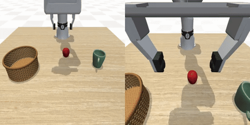
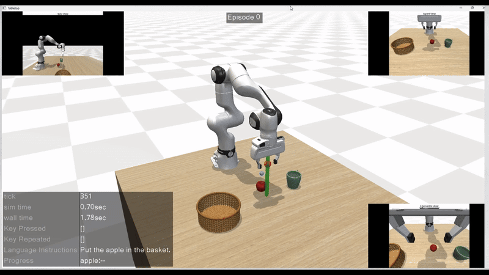
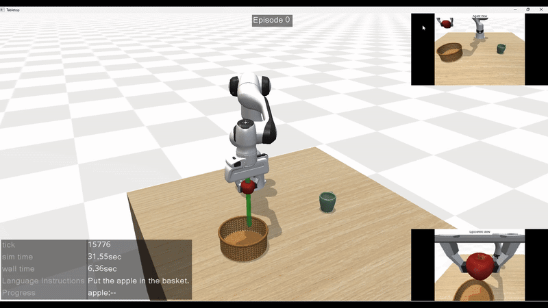
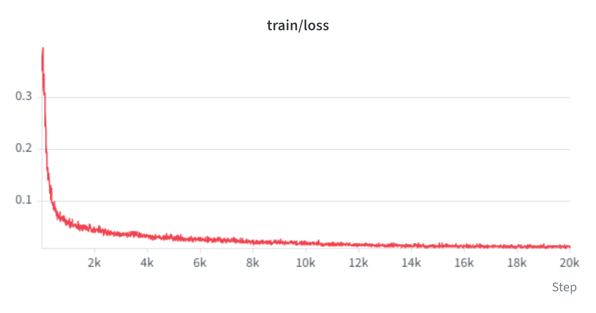
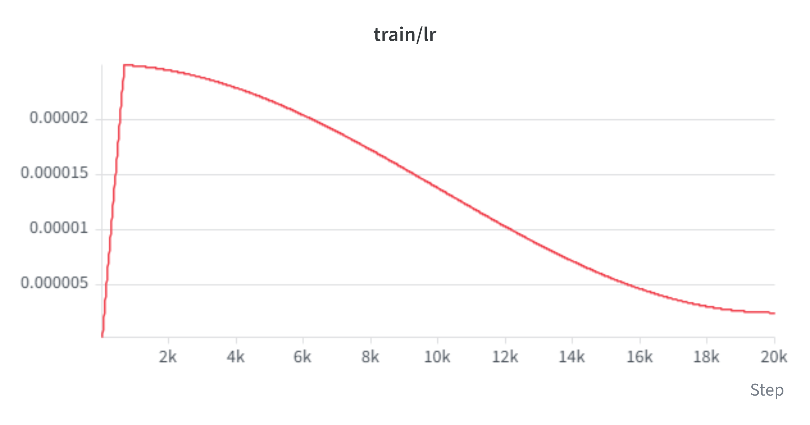
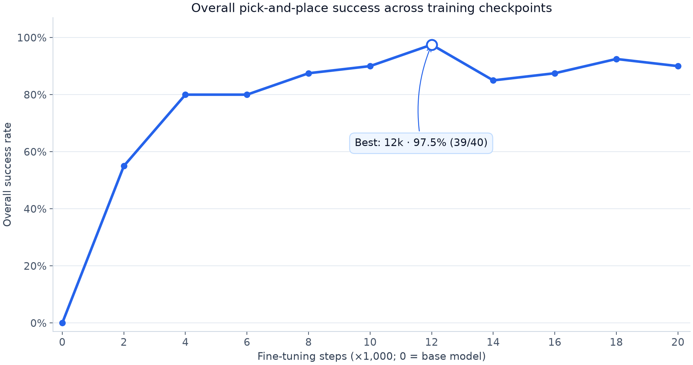
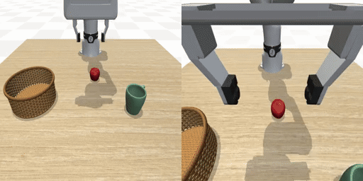

<h1 align="center">Pi05 × MuJoCo</h1>

<h3 align="center">Language-Guided Pick-and-Place with π0.5</h3>

<p align="center">
  <a href="readme.md">English</a> · 简体中文</a>
</p>

<p align="center">
  🤗 <a href="https://huggingface.co/Metroooooooo/pi05_fr3_finetuned_12k">Model</a> · 
  <a href="https://huggingface.co/datasets/Metroooooooo/fr3-pick-place-dataset">Dataset</a>
</p>

<a id="项目简介"></a>

## 📌 项目简介

使用 **Franka FR3 七轴机械臂与平行夹爪**，基于 MuJoCo 和 LeRobot 完成从示范采集到策略部署的闭环流程。微调 [`lerobot/pi05_base`](https://huggingface.co/lerobot/pi05_base)，根据语言指令将苹果、绿色杯子或两者放进篮子。

<p align="center">
  
</p>
<p align="center"><sub>12k checkpoint · 自主推理 · 2 倍速播放</sub></p>

当前数据集包含 **120 条成功示范、39,747 帧数据**，以 **20 Hz** 记录固定相机和腕部相机图像。已评测的 checkpoint 中，**12,000 步**模型取得最高成功率 **97.5%（39/40）**。

<a id="目录"></a>

## 📚 目录

- [🛠️ 安装环境](#安装环境)
- [🎮 遥操收集数据](#遥操收集数据)
- [🎬 回放数据](#回放数据)
- [🧠 训练 π0.5](#训练-pi05)
- [🤗 模型和数据集](#模型和数据集)
- [🚀 部署 π0.5](#部署-pi05)
- [📈 结果](#结果)
- [📍 位置泛化性测试](#位置泛化性测试)
- [🙏 致谢](#致谢)

<details>
<summary>📂 项目结构</summary>

```text
Pi05-Mujoco/
├── 1.collect_data_pick_place.py   # 键盘遥操采集
├── 2.replay_data_pick_place.py    # 仿真回放
├── 3.train_pi05.py               # Pi05微调
├── 4.deploy_pi05.py              # 三种任务部署评测
├── 5.position_generation_test.py # 位置泛化评测
├── asset/                       # FR3、物体、篮子及场景资源
├── mujoco_env/                  # 仿真环境与机器人控制
├── tools/                       # 运行依赖与辅助工具
├── docs/                        # 参数、输出格式与评测数据
├── media/                       # GIF、训练曲线与评测图表
├── environment.yml              # 本地Conda环境入口
├── requirements.txt             # 本地与云端共用依赖
├── requirements_train.txt       # 云端训练与部署依赖
├── install_local.bat            # Windows / Conda安装脚本
└── install_remote.sh            # 云端GPU / uv安装脚本
```

`pick_place_data/` 与 `outputs/` 在本地生成，不需要上传到 GitHub 源码仓库。场景资源及 `tools/` 中的运行依赖需要保留，包括 `pi05_runtime.py`、`replay_video.py` 和 `__init__.py`。

</details>

<a id="安装环境"></a>

## 🛠️ 安装环境

两端统一使用 **Python 3.12**：本地 Windows 负责采集与回放，云端 Linux GPU 服务器负责训练与部署。固定依赖包含 **MuJoCo 3.1.6**、**LeRobot 0.6.1**、**PyTorch 2.11.0**；云端安装 CUDA 12.8 版本的 PyTorch。

<a id="本地windows--conda"></a>

### 💻 本地：Windows + Conda

在项目目录打开 **Anaconda Prompt**：

```bat
cd /d D:\VLA\Pi05-Mujoco
install_local.bat
conda activate lerobot_pi05
```

脚本根据 `environment.yml` 创建或复用 `lerobot_pi05` 环境，安装 `requirements.txt`，并执行 `pip check`。

<a id="云端-gpu"></a>

### ☁️ 云端 GPU：Linux + uv

在云端 GPU 服务器的项目根目录执行：

```bash
python -m pip install --user uv -i https://mirrors.aliyun.com/pypi/simple
bash install_remote.sh
apt-get update
apt-get install -y libegl1 libgl1 libglfw3
source .venv/bin/activate
```

`requirements_train.txt` 已包含公共依赖，通过安装脚本一次安装即可，无需提前单独安装 `requirements.txt`。云端脚本使用国内镜像，并检查依赖完整性。

<a id="准备模型缓存"></a>

### 📦 准备模型缓存

以下运行命令使用 `--offline`，首次运行前需要在云端缓存底座权重和分词器：

```bash
export HF_HOME="$(dirname "$PWD")/hf-cache"
export HF_HUB_CACHE="$HF_HOME/hub"
export HF_ENDPOINT=https://hf-mirror.com
hf download lerobot/pi05_base --max-workers 3
```

PaliGemma 分词器可能需要有访问权限的 Hugging Face 账号。获得权限后，登录并从官方端点缓存体积较小的分词器与配置文件：

```bash
HF_ENDPOINT=https://huggingface.co hf auth login
HF_ENDPOINT=https://huggingface.co hf download google/paligemma-3b-pt-224 \
  --include 'tokenizer*' 'special_tokens_map.json' 'config.json'
```

新终端中也需保留上述缓存变量，或通过 `--policy-path` 指定本地模型目录。需要联网获取尚未缓存的文件时，移除 `--offline`。

<a id="遥操收集数据"></a>

## 🎮 遥操收集数据

在本地运行，并将焦点放在仿真窗口：

```bash
python 1.collect_data_pick_place.py --num-demo 30 --seed 1 --root ./pick_place_data
```

`--num-demo` 表示**本次新增的成功 episode 数量**，兼容的数据集会自动续采。首次非零控制动作后开始记录，满足任务成功条件后自动保存；按 `Z` 丢弃当前尝试。

| 按键 | 功能 |
| --- | --- |
| `W A S D` | 水平移动 |
| `R / F` | 上升 / 下降 |
| `Q / E`、方向键 | 调整末端姿态 |
| `Space` | 开合夹爪 |
| `Z` | 丢弃当前 episode 并重置 |



数据采用 **LeRobot v3** 格式：

```text
pick_place_data/
├── data/chunk-000/file-*.parquet
├── meta/
│   ├── info.json
│   ├── stats.json
│   ├── tasks.parquet
│   └── episodes/chunk-000/file-*.parquet
└── videos/
    ├── observation.images.agentview/chunk-000/file-*.mp4
    └── observation.images.wrist/chunk-000/file-*.mp4
```

| 字段 | 形状 | 含义 |
| --- | --- | --- |
| `observation.images.agentview` | `256 × 256 × 3` | 固定相机 RGB 视频 |
| `observation.images.wrist` | `256 × 256 × 3` | 腕部相机 RGB 视频 |
| `observation.state` | `7` | FR3 实际关节角，单位为弧度 |
| `action` | `8` | 7 维绝对关节目标角 + 夹爪闭合量（`0` 张开、`1` 闭合） |
| `obj_init` | `14` | 苹果、杯子的初始位姿，各为 `[x, y, z, qw, qx, qy, qz]` |
| `task_index` | `1` | 对应 `meta/tasks.parquet` 中的语言指令 |

关节状态和动作按原始物理值存储，训练时由处理器根据数据统计量归一化。`obj_init` 用于回放恢复场景，不作为策略输入。

<a id="回放数据"></a>

## 🎬 回放数据

```bash
python 2.replay_data_pick_place.py --root ./pick_place_data
```

仿真恢复录制时的物体初始位姿，并执行保存的动作；相机叠加窗口显示录制的视频。播放完一条 episode 后自动切换，全部播放完会循环。



<a id="训练-pi05"></a>

## 🧠 训练 π0.5

将完整的 `pick_place_data/` 上传至云端 GPU 服务器，激活环境并登录 W&B：

```bash
source .venv/bin/activate
wandb login
python 3.train_pi05.py \
  --policy-path lerobot/pi05_base \
  --data-root ./pick_place_data \
  --offline \
  --gradient-checkpointing false \
  --batch-size 16 \
  --num-workers 8 \
  --steps 20000 \
  --save-freq 2000 \
  --log-freq 10 \
  --wandb true \
  --out ./outputs/train/pi05_fr3_pick_place
```

本次训练使用 **batch size 16**、**20k 总步数**、**8 个数据加载进程**、**CUDA + bfloat16**，每 **2k 步**保存一次 checkpoint。视觉编码器冻结，`train_expert_only=false`，关闭梯度检查点。W&B 记录训练指标，默认不上传模型副本。

中断后从最近保存的 checkpoint 恢复：

```bash
python 3.train_pi05.py --resume --offline --wandb true \
  --out ./outputs/train/pi05_fr3_pick_place
```

[训练参数与 checkpoint 输出格式 →](docs/training_zh.md)

<table>
  <tr>
    <td align="center"><br><sub>训练 Loss</sub></td>
    <td align="center"><br><sub>学习率</sub></td>
  </tr>
</table>

<a id="模型和数据集"></a>

## 🤗 模型和数据集

**12k 步微调模型**和包含 **120 条示范的数据集**的 Hugging Face 仓库链接如下，上传完成后可用：

| 资源 | Hugging Face 链接 |
| --- | --- |
| π0.5_finetuned | [模型](https://huggingface.co/Metroooooooo/pi05_fr3_finetuned_12k) |
| Dataset | [数据集](https://huggingface.co/datasets/Metroooooooo/fr3-pick-place-dataset) |

<a id="部署-pi05"></a>

## 🚀 部署 π0.5

以下命令评测结果中使用的 **12k checkpoint**：

```bash
python 4.deploy_pi05.py \
  --policy-path ./outputs/train/pi05_fr3_pick_place/checkpoints/012000/pretrained_model \
  --data-root ./pick_place_data \
  --offline \
  --both-runs 20 \
  --both-max-steps 1500 \
  --seed 100 \
  --out ./outputs/deploy/deploy_finetuned_12k
```

苹果和杯子任务分别评测 **10 次**，每次最多 **1,000 个控制步**；双目标任务评测 **20 次**，每次最多 **1,500 步**。20 Hz 下分别对应最多 50 秒和 75 秒仿真时间，实际耗时还取决于推理速度。成功条件为：所有指令目标均入篮、夹爪张开、末端退到 0.9 m 以上。

[部署参数与结果输出格式 →](docs/deployment_zh.md)


<a id="结果"></a>

## 📈 结果



所有 checkpoint 使用相同的任务次数、步数上限，以及从 seed 100 开始的场景种子序列。总体成功率按 **40 次实际评测加权计算**：苹果 10 次、杯子 10 次、双目标 20 次。

**已评测的 checkpoint 中，12k 模型成功率最高：总体 97.5%（39/40）。** 训练虽然继续到 20k 步，但训练 loss 最低的模型并未在这组 rollout 中取得最高成功率。

| Checkpoint | 苹果 | 绿色杯子 | 双目标 | 总体 |
| --- | ---: | ---: | ---: | ---: |
| Base | 0% | 0% | 0% | 0% |
| 2k | 70% | 40% | 55% | 55% |
| 4k | 70% | 100% | 75% | 80% |
| 6k | 100% | 100% | 60% | 80% |
| 8k | 90% | 90% | 85% | 87.5% |
| 10k | 100% | 100% | 80% | 90% |
| **12k** | **100%** | **100%** | **95%** | **97.5%** |
| 14k | 100% | 80% | 80% | 85% |
| 16k | 100% | 100% | 75% | 87.5% |
| 18k | 100% | 100% | 85% | 92.5% |
| 20k | 100% | 90% | 85% | 90% |

[原始分数 CSV](docs/success_rates.csv) · [评测配置与统计 JSON](docs/evaluation_results.json)

这些数值来自一组有限次数的评测；不能据此认定多次独立训练、独立评测下 checkpoint 排名仍然相同。

<a id="位置泛化性测试"></a>

## 📍 位置泛化性测试

保留两个物体的原生成中心，仅在**边长 15 cm 的新正方形内、边长 10 cm 的旧正方形外**生成。物体不交换位置，保留原有间距约束，落稳后再次检查位置是否合格。

```bash
python 5.position_generation_test.py \
  --policy-path ./outputs/train/pi05_fr3_pick_place/checkpoints/012000/pretrained_model \
  --data-root ./pick_place_data \
  --offline \
  --both-runs 20 \
  --max-steps 2000 \
  --outer-side 0.15 \
  --seed 100 \
  --out ./outputs/position_generation_test
```

重新评测时使用新的输出目录。`--outer-side` 控制新正方形边长，单位为米。

| 任务 | 成功次数 | 成功率 |
| --- | ---: | ---: |
| 苹果 | 8 / 10 | 80% |
| 绿色杯子 | 10 / 10 | 100% |
| 双目标 | 14 / 20 | 70% |
| **总体** | **32 / 40** | **80%** |

这组结果使用 **12k checkpoint**、seed 100，各任务每次上限均为 **2,000 步**。它的时限比上面的标准评测更长，因此两个成功率不能直接解释为只改变位置的严格对照实验。



<a id="致谢"></a>

## 🙏 致谢

- [LeRobot MuJoCo Tutorial](https://github.com/jeongeun980906/lerobot-mujoco-tutorial)：本项目参考的仿真与示范学习流程。
- [Hugging Face LeRobot](https://github.com/huggingface/lerobot)：数据集工具、Pi05 接入及训练基础设施。
